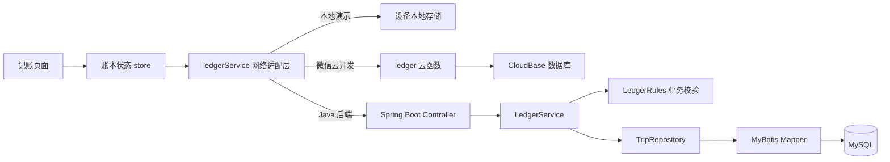

# 一起去：项目架构与代码导览

这份文档写给刚开始接触这个项目的人。可以先看“整体怎么工作”，再按“建议阅读顺序”逐步打开代码。

## 先认识这个项目

这是一个旅行 AA 账本小程序。朋友创建旅行后，可以加入同一个账本、记录共同开销、计算每个人垫付和应承担的金额，再按建议自行转账并确认到账。

项目由两部分组成：

- **小程序前端**：Taro、React 和 TypeScript，负责页面、表单和向服务端发送请求。
- **服务端**：目前保留两种实现。微信云开发版本在 `cloud/`，Java 版本在 `jiqian-server/`。两者都提供相同的账本功能。

`shared/ledger.ts` 放着前端和云函数共用的 TypeScript 账本规则。Java 后端在 `LedgerRules.java` 中实现同一组规则。规则的关键结果应保持一致。

## 一次操作如何走完整条链路

以“记录一笔开销”为例：



小程序页面不用知道账本保存在什么地方。页面只调用 `store` 提供的方法；`src/services/ledger.ts` 根据构建配置选择本地演示、微信云函数或 Java API。

## 当前项目可运行的三种模式

模式在**构建时**由 `.env.local` 的环境变量决定。这个文件只保存在开发者电脑上，已经被 Git 忽略，不要提交密钥。

| 构建条件 | 使用的数据位置 | 适合做什么 |
| --- | --- | --- |
| H5 浏览器 | 本地演示数据 | 快速体验界面；H5 不调用微信云函数或 Java API |
| 微信小程序，未设置云环境和 API 地址 | 本地演示数据 | 离线体验和测试多人流程 |
| 微信小程序，设置 `TARO_APP_CLOUD_ENV`，没有 API 地址 | CloudBase 云函数和云数据库 | 当前微信云开发版本 |
| 微信小程序，设置 `TARO_APP_API_BASE_URL` | Java API 和 MySQL | 本地或部署后的 Java 后端 |

如果 API 地址和云环境都填写了，小程序会优先使用 Java API。地址由 `config/index.ts` 编译进小程序，所以修改 `.env.local` 后要重新运行 Taro 构建，并在微信开发者工具中重新编译。

本机运行 Java 版本时，`http://127.0.0.1:8080` 只表示开发电脑本身。真机不能直接访问开发电脑的 `127.0.0.1`；真机联调需要配置可访问的局域网地址或 HTTPS 服务域名。

## 文件夹地图

```text
jiqian-mini/
├── src/                         # 小程序与 H5 的页面、组件和前端状态
│   ├── app.tsx                  # React 应用入口，挂载账本状态
│   ├── app.config.ts            # 页面注册和小程序窗口设置
│   ├── app.scss                 # 全局样式
│   ├── pages/                   # 六个页面：旅行、总览、记账、账单、旅伴、结算
│   ├── components/              # 多个页面共用的界面组件
│   ├── services/ledger.ts       # 数据来源适配：演示 / CloudBase / Java API
│   ├── store.tsx                # React Context 状态、加载、刷新与页面导航辅助函数
│   └── share.ts                 # 微信小程序分享卡片和邀请路径
├── shared/                      # 前端和云函数共用的数据类型与账本规则
│   ├── types.ts                 # User、Trip、Expense、Command 等结构
│   ├── ledger.ts                # 校验、AA 均分、余额、转账建议和权限规则
│   └── demo.ts                  # 本地演示用户和示例旅行
├── cloud/                       # 微信云函数的 TypeScript 源码
│   ├── index.ts                 # 微信 SDK 入口，读取调用者 OpenID
│   ├── handler.ts               # 云函数动作分发、数据库事务和数据读写
│   └── database.rules.json      # 云数据库客户端权限规则
├── cloudfunctions/ledger/       # 微信开发者工具识别并部署的云函数目录
│   ├── index.js                 # npm run build:cloud 生成的 JavaScript 部署产物（未生成时暂不存在）
│   ├── package.json             # 云函数依赖和 Node 版本
│   └── config.json              # 超时时间等云函数部署设置
├── jiqian-server/               # Java 17 + Spring Boot + MyBatis + MySQL 后端
│   ├── src/main/java/com/jiqian/
│   │   ├── JiqianApplication.java # Spring Boot 启动入口
│   │   ├── controller/          # AuthController 登录；LedgerController 账本 API
│   │   ├── service/             # LedgerService 用例/事务；TripRepository 数据转换
│   │   ├── domain/              # Models 数据结构；Command 请求动作；LedgerRules 规则
│   │   ├── mapper/              # LedgerMapper 中的 MyBatis SQL
│   │   ├── auth/                # 微信 code 换 OpenID、JWT 签发与拦截
│   │   ├── common/              # API 返回结构、业务异常和统一异常转换
│   │   └── config/              # Spring Web、外部请求和鉴权配置
│   ├── src/main/resources/
│   │   ├── application.yml      # 服务端口、数据库、微信和 JWT 配置
│   │   └── schema.sql           # MySQL 表结构，应用启动时创建缺失表
│   ├── src/test/                # Java 领域和服务层的自动化测试
│   ├── .env.example             # 本地环境变量模板；真实 .env 不提交
│   ├── compose.yaml             # 本地 MySQL 容器
│   ├── Dockerfile               # Java 后端镜像构建方式
│   ├── pom.xml                  # Maven 依赖、Java 版本和打包设置
│   ├── mvnw                     # Maven Wrapper（macOS/Linux）
│   ├── mvnw.cmd                 # Maven Wrapper（Windows）
│   └── run-local.sh             # 加载 .env 并启动后端
├── scripts/
│   ├── build-cloud.mjs          # 将 cloud/index.ts 编译到部署目录
│   ├── cloud-export-to-sql.mjs  # CloudBase users/trips 导出转成 MySQL 导入 SQL
│   └── smoke-h5.mjs             # 浏览器交互冒烟脚本（先构建 H5 再执行）
├── tests/                       # TypeScript 账本规则和云函数契约测试
├── docs/                        # 开发、迁移和架构说明
├── artifacts/                   # 项目截图和手工验证记录
├── config/index.ts              # Taro 构建配置和环境变量注入
├── types/global.d.ts            # 编译时环境常量类型声明
├── project.config.json          # 微信开发者工具项目设置
├── package.json                 # 前端命令和依赖
├── package-lock.json            # 锁定 npm 依赖版本，保证安装结果一致
├── tsconfig.json                # TypeScript 编译规则
├── .env.example                 # 本地 Taro 构建环境变量模板
└── .gitignore                   # 忽略依赖、构建结果和本地密钥
```

`dist/`、`dist-h5/`、`node_modules/` 和 `jiqian-server/target/` 都是构建或依赖目录。它们可以由工具重新生成，不是手写业务源码。
`jiqian-server/.idea/` 是 IntelliJ IDEA 的个人项目设置，不参与程序运行；刚入门时可以忽略。

## 前端部分从哪里看

### 页面

`src/app.config.ts` 注册页面。页面路由和主要职责如下：

| 页面 | 文件 | 用途 |
| --- | --- | --- |
| 我的旅行 | `src/pages/trips/index.tsx` | 创建旅行、填写邀请码加入、查看旅行列表 |
| 总览 | `src/pages/overview/index.tsx` | 显示旅行总开销、个人余额和最近账单 |
| 记账 | `src/pages/expense/index.tsx` | 新增、修改或软删除一笔开销 |
| 账单 | `src/pages/bills/index.tsx` | 搜索和筛选旅行账单 |
| 旅伴 | `src/pages/members/index.tsx` | 查看成员、个人余额和旅行动态 |
| 结算 | `src/pages/settlement/index.tsx` | 查看待付/待收、标记转账、确认到账 |

每个页面旁边的 `index.config.ts` 设置微信标题；旅行列表和四个账本 tab 页面还会开启微信转发入口，分享标题和路径由 `src/share.ts` 提供。记账表单是独立页面，不属于底部 tab。页面内容写在 `index.tsx`。`src/components/ui.tsx` 提供头像、金额、页面框架、底部导航、空状态和账单行等组件。`src/components/trip-name.tsx` 单独处理“我在本次旅行中的名字”。

`src/app.scss` 放跨页面共用样式；`config/index.ts` 选择微信/H5 构建目标，并把 `.env.local` 中的公开 API 地址和云环境 ID 编译进前端。`types/global.d.ts` 只告诉 TypeScript 这些编译时常量是什么类型，不会在运行时读取环境变量。

### 状态与数据请求

- `src/store.tsx` 用 React Context 保存当前用户、旅行列表、加载状态和错误状态。页面通过 `useLedger()` 或 `useTrip()` 读取。
- `useTrip()` 从页面路由取得 `tripId`；CloudBase 或 Java 后端模式下，页面重新显示时读取最新账本，并每 15 秒刷新一次。
- `src/services/ledger.ts` 把页面的 `create`、`join`、`bootstrap`、`command` 操作转换为对应的数据请求。
- 演示模式使用 Taro 的本机存储；CloudBase 模式调用 `ledger` 云函数；Java 模式用 `wx.login()` 换取服务端 JWT，再向 `/api/...` 请求。

如果页面布局有问题，先看对应 `pages` 文件和 `app.scss`。如果按钮操作了但数据没变化，沿着页面 → `store.tsx` → `services/ledger.ts` → 当前服务端这条链路排查。

## 账本数据和几个重要规则

TypeScript 结构定义在 `shared/types.ts`，Java 结构定义在 `jiqian-server/src/main/java/com/jiqian/domain/Models.java`。

- **User**：微信用户 ID 和默认昵称。
- **Trip**：一次旅行，是成员、费用、转账和操作记录的归属单位。`version` 用来发现并发修改。
- **Member**：成员在某一次旅行中的昵称、头像颜色和是否仍有效。成员昵称只属于该旅行。
- **Expense**：一笔开销，保存付款人、参与分摊的人和软删除状态。删除只把 `deleted` 改为 `true`，不会抹掉历史记录。
- **Settlement**：朋友间手动转账的账本标记，状态为 `pending`、`confirmed` 或 `cancelled`。程序不会真的从微信扣款。
- **AuditEntry**：谁在什么时候做了什么操作。
- **Command**：对账本执行的动作，例如新增账单、确认转账或关闭账本。前端和后端用 `type` 字段区分动作。

金额统一用整数“分”保存和计算；`money()` 只在显示时换算成人民币。均分时若无法整除，剩余的几分钱按成员 ID 的固定顺序分配，保证总分摊金额严格等于账单金额。

共享规则的主要实现是 `shared/ledger.ts`；Java 版对应 `LedgerRules.java`。业务规则应在服务端再检查一次，不能只依赖页面隐藏按钮。

## Java 后端的一次请求

```text
小程序请求
  → AuthController / LedgerController
  → JWT 拦截器确认用户身份
  → LedgerService 开启数据库事务并协调一次用例
  → LedgerRules 检查权限和账本规则
  → TripRepository 组合/拆分旅行数据
  → LedgerMapper 执行 SQL
  → MySQL
```

Java 后端的职责：

- `controller/`：定义外部 HTTP 路径，不在这里堆放复杂账本规则。
- `service/LedgerService.java`：处理创建、加入和命令请求，并在事务中调用数据层。
- `domain/LedgerRules.java`：Java 版纯业务规则；尽量不依赖 Spring 或数据库。
- `service/TripRepository.java`：把多张关系表拼成前端使用的 `Trip`，并在保存时拆回多张表。
- `mapper/LedgerMapper.java`：SQL 和表字段映射。
- `resources/schema.sql`：首次启动时创建所需表。
- `auth/`：微信临时登录码换 OpenID，再由服务器签发 JWT。AppSecret 和 JWT 密钥只放在服务端 `.env`。

主要 API：

| 方法 | 路径 | 用途 |
| --- | --- | --- |
| `POST` | `/api/auth/login` | 用微信 `wx.login()` 返回的临时 code 登录 |
| `GET` | `/api/bootstrap` | 读取当前用户和参与的旅行 |
| `POST` | `/api/trips` | 创建旅行 |
| `POST` | `/api/trips/join` | 使用邀请码加入旅行 |
| `POST` | `/api/trips/{tripId}/commands` | 对账本执行一种 Command |

除登录外的 API 都需要 `Authorization: Bearer <JWT>`。身份从已签名的 JWT 获取，客户端不能自行指定 OpenID。

## 微信云函数部分

`cloud/index.ts` 是真正的微信云函数入口：初始化微信 SDK，并从微信调用上下文读取 OpenID。`cloud/handler.ts` 负责分发 `bootstrap`、`create`、`join`、`command` 四类操作。

云数据库把一趟旅行作为一个聚合文档保存在 `trips` 集合里，因此一个修改会在 CloudBase 事务中读取、检查和整体写回。`users` 保存用户信息；`invites` 把不可预测的邀请码映射到旅行 ID。数据库对客户端关闭直接读写，业务请求必须经过云函数。

改完 `cloud/` 源码后，执行 `npm run build:cloud` 更新 `cloudfunctions/ledger/index.js`，再通过微信开发者工具上传部署云函数。

`cloudfunctions/ledger/package.json` 声明云端需要的 SDK；`config.json` 是微信工具读取的超时和权限设置。`index.js` 是构建产物，应从 TypeScript 源码重新生成，不要直接在打包文件里改业务逻辑。

## 建议的阅读顺序

1. `src/app.config.ts`：先看项目有哪些页面。
2. `src/pages/trips/index.tsx`：了解从哪里进入和创建旅行。
3. `src/store.tsx`：了解页面如何拿到旅行数据。
4. `src/services/ledger.ts`：了解本地、CloudBase 和 Java 三种数据来源。
5. `shared/types.ts`：认识页面之间传递的数据长什么样。
6. `shared/ledger.ts`：看 AA 均分、余额和命令规则。
7. 决定使用哪个后端后，再读 `cloud/handler.ts` 或 `jiqian-server/`。

第一次读代码时可以顺着“点创建旅行 → `store.create()` → `ledgerService.create()` → 服务端 `create` → 返回 `Trip`”追一遍。写账单、加入旅行和结算也是类似的路径。

## 本地运行与常用命令

前端需要 Node.js；Java 后端需要 JDK 17 和 Docker。

```bash
# 项目根目录：安装 JavaScript 依赖并监听微信小程序构建
npm ci
npm run dev:weapp

# 新终端：在 jiqian-server 目录启动本地 MySQL 和 Java API
cd jiqian-server
docker compose up -d mysql
./run-local.sh
```

然后在微信开发者工具中导入项目根目录。开发服务器把编译结果放在 `dist/`。如果使用 `TARO_APP_API_BASE_URL=http://127.0.0.1:8080`，小程序请求本机 Java API；如果清空该地址并填写云环境 ID，则请求云函数。

常用前端命令见根目录 `package.json`：`npm run typecheck` 检查类型，`npm test` 跑 Vitest 测试，`npm run build:weapp` 构建小程序，`npm run build:cloud` 构建云函数，`npm run build:h5` 构建 H5。

账本导入脚本是 `scripts/cloud-export-to-sql.mjs`，用法和字段要求见 `jiqian-server/README.md`。

## 新手改代码时的定位提示

- **改页面文字、布局**：从对应的 `src/pages/` 文件开始；共用样式看 `src/app.scss`。
- **改均分、余额或权限规则**：先看 `shared/ledger.ts`，并同步确认 Java 的 `LedgerRules.java`。
- **改 API 路径或登录**：前端看 `src/services/ledger.ts`；后端看 `controller/` 和 `auth/`。
- **改云开发数据库读写**：看 `cloud/handler.ts`，不要绕过云函数在客户端直接读写。
- **改 MySQL 表或查询**：表结构在 `schema.sql`，SQL 在 `LedgerMapper.java`，对象组合在 `TripRepository.java`。
- **改小程序页面列表或窗口标题**：看 `src/app.config.ts`。
- **遇到操作错误**：看页面是否调用了正确的 store 方法，再看服务端返回的错误文字；不要先删本地数据库或 `target/`。
